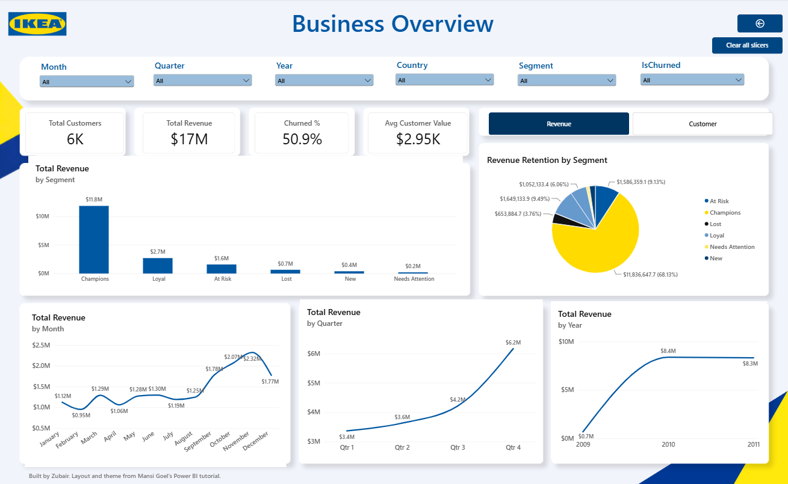
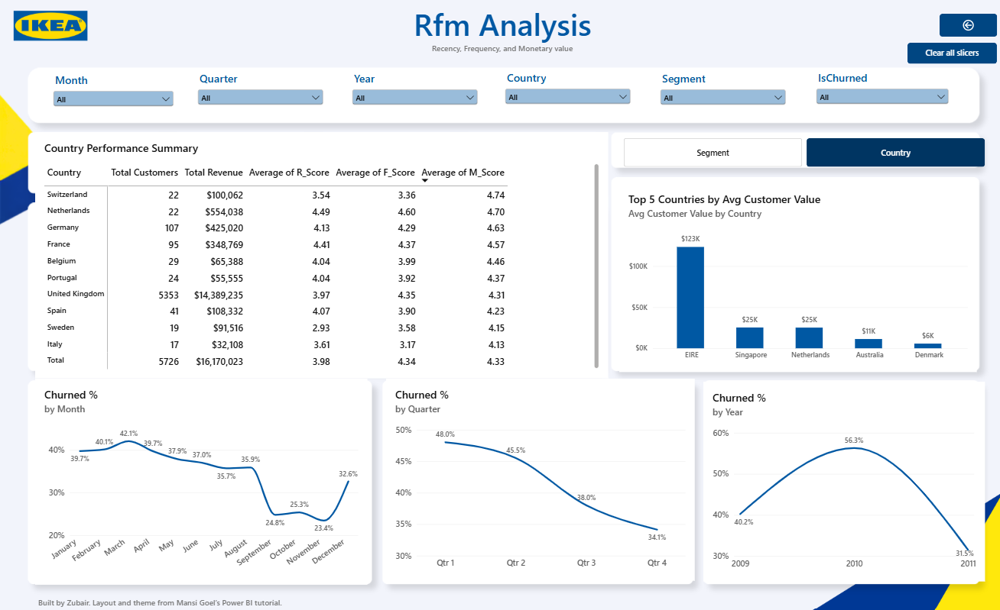

# Online Retail Customer Segmentation (RFM)

Customer segmentation on about one million UK online retail transactions, using SQL Server for cleaning, Python for RFM scoring and Power BI for the dashboard.

I built this by following Mansi Goel's SQL, Python and Power BI tutorial series and ran every step myself on my own machine.

## Data

Online Retail II, UCI Machine Learning Repository, donated by Daqing Chen. Licensed under CC BY 4.0. Two years of transactions from a UK based online gift retailer, December 2009 to December 2011, split across two sheets.

The raw dataset isn't included in this repository and can be downloaded from the UCI Machine Learning Repository. The Power BI file does contain the processed data the dashboard was built on.

## What I did

**1. Cleaning in SQL Server** (`sql/01_clean_and_deduplicate.sql`)

- Imported both yearly sheets into SQL Server and combined them with UNION ALL into one table
- Converted dates and prices with TRY_CONVERT so a single bad value wouldn't stop the import, then counted how many conversions failed
- Checked for missing customer IDs, zero or negative quantities, missing descriptions and exact duplicate rows
- Removed exact duplicates with ROW_NUMBER() into a new table, keeping the original combined table so the before and after can be compared

After cleaning there were 1,033,036 transactions. About 23% of them (235,151) had no customer ID. Those can still count towards sales totals, but they can't be assigned to a customer.

**2. RFM segmentation in Python** (`notebooks/rfm_segmentation.ipynb`)

SSMS exported the cleaned table without headers, so I set the column names in pandas when loading it.

For the customer analysis I kept only rows with a customer ID and a positive quantity, then scored every customer from 1 to 5 on:

- Recency: days since their last purchase, measured from 10 December 2011
- Frequency: number of separate invoices
- Monetary: total spend

Those scores sort customers into six segments: Champions, Loyal, At Risk, New, Needs Attention and Lost. Customers with no purchase in the last 90 days are also flagged as churned.

The scores were merged back onto the transactions and exported as an Excel file for the dashboard.

**3. Dashboard in Power BI** (`dashboard/rfm_dashboard.pbix`)

I loaded the Excel file into Power BI, fixed the column types (the invoice dates came in as plain numbers at first) and wrote the measures in DAX: total revenue, distinct customers, churn rate and average value per customer.

The page layout, background and colour theme come from the tutorial. The measures, charts, slicers and bookmarks I set up myself.

The report has two pages:

- **Business Overview**: KPI cards, slicers for month, quarter, year, country, segment and churn status, and bookmark buttons that switch the charts between a revenue view and a customer view
- **RFM Analysis**: summary tables by segment and by country with average R, F and M scores, average customer value, and churn rate by month, quarter and year. Bookmarks switch between the segment view and the country view

The file opens in Power BI Desktop, which is free.

## What the numbers say

- 5,881 customers, and 50.9% of them hadn't bought anything in the last 90 days of the data
- Champions are 22% of customers but bring in 68% of the revenue
- Lost is the biggest group with 1,524 customers (26%), yet it accounts for less than 4% of revenue
- Customers flagged as churned still made up about $3.4M of the $17.4M total, roughly a fifth of revenue

## Things to keep in mind

- Rows without a customer ID were left out of the segmentation, not deleted from the data
- The positive quantity filter leaves out returns, so spend here is before returns
- Some identical lines could be genuine repeat purchases rather than duplicates. The rule removes them anyway, which matters when reading the totals
- The 90 day churn flag is a simple rule, not a prediction model
- Scores are relative to this dataset. A 5 just means the top 20% of these customers
- The average R, F and M scores in the dashboard tables are averaged over transactions, so a customer with 200 orders counts 200 times. Averaged per customer, all three come out at about 3.0, as they should with five equal sized score groups
- The top 5 countries by average customer value include countries with very few customers. Singapore has one customer and EIRE has five, so those averages say more about a handful of buyers than about the country
- When I imported the two Excel sheets into SQL Server, the table names ended up swapped, so rows labelled 2009-2010 in the SourceSheet column actually hold the 2010-2011 data and the other way round. Duplicates were removed across both tables, so the totals aren't affected, and the column isn't used in any chart

## Tools

SQL Server, SSMS, Python, pandas, Jupyter, Power BI
